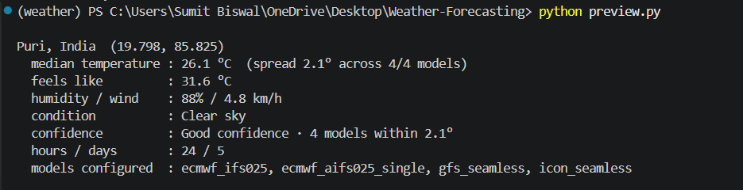
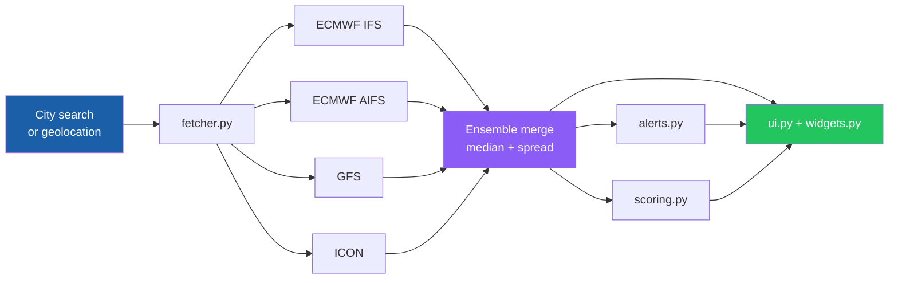

<div align="center">


<br/>

[](https://python.org)
[](https://doc.qt.io/qtforpython/)
[](https://open-meteo.com/)
[](LICENSE)


**A modern desktop weather app that asks four world-class models, shows you where they disagree, and grades its own accuracy.**

[✨ Features](#-features) &nbsp;•&nbsp;
[📸 Screenshots](#-screenshots) &nbsp;•&nbsp;
[🚀 Quick Start](#-quick-start) &nbsp;•&nbsp;
[🔬 How It Works](#-how-it-works) &nbsp;•&nbsp;
[🗺️ Roadmap](#%EF%B8%8F-roadmap)

<br/>


</div>

<br/>

## 🌟 At a Glance

<table align="center">
  <tr>
    <td align="center" width="25%"><h3>4</h3><sub>weather models<br/>queried in parallel</sub></td>
    <td align="center" width="25%"><h3>24h + 5d</h3><sub>hourly strip and<br/>daily outlook</sub></td>
    <td align="center" width="25%"><h3>0</h3><sub>API keys<br/>required</sub></td>
    <td align="center" width="25%"><h3>MAE + Hit&nbsp;Rate</h3><sub>self-scored vs.<br/>persistence &amp; IFS</sub></td>
  </tr>
</table>

---

## 🎯 Why This Project

Most weather apps present one model's output as if it were certain. But models disagree, and that disagreement is useful information.

**Weather Forecasting** queries several independent models at once, reports the **median**, shows **how far apart they are**, and then checks itself against what actually happened, so you can see *how much to trust* a forecast, not just what it says.

> 💡 **Narrow spread = models agree. Wide spread = treat the forecast with caution.**

---

## ✨ Features

<table>
  <tr>
    <td width="33%" valign="top">
      <h3>🧠 Ensemble Forecasts</h3>
      Queries <b>ECMWF IFS</b>, <b>ECMWF AIFS</b>, <b>GFS</b> and <b>ICON</b> in parallel and reports the median temperature with a confidence spread.
    </td>
    <td width="33%" valign="top">
      <h3>📈 Self-Scoring Accuracy</h3>
      Grades forecasts against observed conditions and benchmarks them against <b>persistence</b> and <b>IFS</b> baselines.
    </td>
    <td width="33%" valign="top">
      <h3>🚨 Severe Weather Alerts</h3>
      Automatic detection of <b>heat, cold, wind, rain</b> and <b>storm</b> conditions.
    </td>
  </tr>
  <tr>
    <td valign="top">
      <h3>📊 Location Scoring</h3>
      Ranks locations by <b>comfort</b>, <b>safety</b> and overall conditions.
    </td>
    <td valign="top">
      <h3>🌗 Sun &amp; Moon Arc</h3>
      Daylight curve with sunrise and sunset markers, plus the current moon phase.
    </td>
    <td valign="top">
      <h3>📅 Hourly &amp; 5-Day</h3>
      A 24-hour strip and 5-day outlook with precipitation probabilities.
    </td>
  </tr>
  <tr>
    <td valign="top">
      <h3>🎨 Adaptive Dark UI</h3>
      Card-based layout with dynamic colors and icons that follow conditions.
    </td>
    <td valign="top">
      <h3>🔍 Search &amp; Geolocation</h3>
      City search with geolocation calibration.
    </td>
    <td valign="top">
      <h3>🖥️ Headless CLI</h3>
      A quick terminal preview of the full ensemble, great for scripting.
    </td>
  </tr>
</table>

---

## 📸 Screenshots

<div align="center">

<table>
  <tr>
    <td align="center">
      
      <br/><sub><b>⏱️ Hourly strip · 5-day outlook · Forecast accuracy</b></sub>
    </td>
  </tr>
  <tr>
    <td align="center">
      
      <br/><sub><b>⌨️ CLI preview · Multi-model ensemble output</b></sub>
    </td>
  </tr>
</table>

</div>

---

## 🔬 How It Works



| Step | What happens |
|:---:|---|
| **1 · Fetch** | Open-Meteo is queried once per configured model, in parallel |
| **2 · Merge** | Responses are normalized; the **median** is reported and the **spread** becomes the confidence signal |
| **3 · Assess** | Alert rules flag hazards; scoring ranks comfort and safety |
| **4 · Grade** | Past forecasts are compared with observations using **MAE** and **hit rate**, against persistence and IFS baselines |

---

## 🚀 Quick Start

> **Requirements:** Python **3.10+** and an internet connection. No API key.

**1 · Clone**

```bash
git clone https://github.com/sonubiswal/Weather-Forecasting.git
cd Weather-Forecasting
```

**2 · Create a virtual environment**

<table>
<tr><th>🪟 Windows</th><th>🍎 macOS / 🐧 Linux</th></tr>
<tr>
<td>

```bash
python -m venv venv
venv\Scripts\activate
```

</td>
<td>

```bash
python3 -m venv venv
source venv/bin/activate
```

</td>
</tr>
</table>

**3 · Install**

```bash
pip install -r requirements.txt
```

**4 · Run**

<table>
<tr><th>🖥️ Desktop GUI</th><th>⌨️ CLI preview</th></tr>
<tr>
<td>

```bash
cd src
python -m weather_app.main
```

</td>
<td>

```bash
python preview.py
```

</td>
</tr>
</table>

<details>
<summary><b>📟 Sample CLI output</b></summary>

```
Puri, India  (19.798, 85.825)
  median temperature : 26.1 °C  (spread 2.1° across 4/4 models)
  feels like         : 31.6 °C
  humidity / wind    : 88% / 4.8 km/h
  condition          : Clear sky
  confidence         : Good confidence · 4 models within 2.1°
  hours / days       : 24 / 5
  models configured  : ecmwf_ifs025, ecmwf_aifs025_single, gfs_seamless, icon_seamless
```

</details>

---

## 🏗️ Architecture

```
Weather-Forecasting/
├── 🖼️  assets/
│   ├── banner.svg
│   └── screenshots/
├── 📦 src/weather_app/
│   ├── __init__.py     # Package metadata and version
│   ├── main.py         # Entry point (QApplication + event loop)
│   ├── fetcher.py      # Open-Meteo client, ensemble merge, normalization
│   ├── scoring.py      # Comfort / safety scoring, accuracy tracking
│   ├── alerts.py       # Severe weather detection rules
│   ├── theme.py        # Dynamic color, font, and icon selection
│   ├── widgets.py      # Reusable PySide6 components (cards, strips, arcs)
│   └── ui.py           # Main window layout and event wiring
├── preview.py          # Headless CLI preview
├── requirements.txt
├── pyproject.toml
└── .env.example
```

| Principle | In practice |
|---|---|
| **Separation of concerns** | Data (`fetcher`), logic (`scoring`, `alerts`) and presentation (`ui`, `widgets`, `theme`) are separate modules |
| **Reusable widgets** | UI building blocks are isolated in `widgets.py` |
| **Provider-agnostic data layer** | Normalization in `fetcher.py` keeps the rest of the app independent of the API's response shape |

---

## ⚙️ Configuration

Open-Meteo needs **no key**, so this is optional. To add a custom provider later:

<table>
<tr><th>🪟 Windows</th><th>🍎 macOS / 🐧 Linux</th></tr>
<tr>
<td>

```bash
copy .env.example .env
```

</td>
<td>

```bash
cp .env.example .env
```

</td>
</tr>
</table>

| Model ID | Provider |
|---|---|
| `ecmwf_ifs025` | 🇪🇺 ECMWF IFS |
| `ecmwf_aifs025_single` | 🤖 ECMWF AIFS |
| `gfs_seamless` | 🇺🇸 NOAA GFS |
| `icon_seamless` | 🇩🇪 DWD ICON |

---

## 🩺 Troubleshooting

<details>
<summary><b>❌ ModuleNotFoundError: No module named 'weather_app'</b></summary>

<br/>

Run from inside `src` using the module form:

```bash
cd src
python -m weather_app.main
```

</details>

<details>
<summary><b>🌐 The app opens but shows no data</b></summary>

<br/>

Check your internet connection and that Open-Meteo is reachable. The CLI line shows how many models responded (for example `4/4 models`).

</details>

<details>
<summary><b>📦 PySide6 fails to install or the window won't launch</b></summary>

<br/>

Use Python 3.10+ and upgrade pip first:

```bash
python -m pip install --upgrade pip
pip install -r requirements.txt
```

On some Linux distributions, Qt may need extra system libraries (for example `libxcb`-related packages).

</details>

<details>
<summary><b>🪟 venv won't activate in PowerShell</b></summary>

<br/>

Use Command Prompt, or allow scripts for the current session:

```powershell
Set-ExecutionPolicy -Scope Process -ExecutionPolicy RemoteSigned
```

</details>

---

## 🛠️ Tech Stack

<div align="center">


</div>

---

## 🗺️ Roadmap

- [ ] 📉 Historical trend charts (30 / 90-day temperature and rainfall)
- [ ] ⭐ Saved locations and quick-switch favorites
- [ ] 🔔 System tray notifications for active alerts
- [ ] 🌓 Light / dark theme toggle
- [ ] 📦 Standalone executable (PyInstaller)
- [ ] 🏆 Expanded accuracy dashboard (per-model scoring breakdown)

Have an idea? [Open an issue](https://github.com/sonubiswal/Weather-Forecasting/issues) 💬

---

## 🤝 Contributing

Contributions, bug reports and feature requests are welcome.

1. 💬 **Open an issue** first to discuss any major change
2. 🍴 **Fork** the repo and create a branch: `git checkout -b feature/your-feature`
3. ✍️ **Commit** with clear, descriptive messages
4. 🚀 **Open a Pull Request** explaining what changed and why

Please keep changes focused, match the existing module structure, and include screenshots for UI changes.

---

## 🙏 Data Attribution

Weather data by **[Open-Meteo.com](https://open-meteo.com/)** under [CC BY 4.0](https://creativecommons.org/licenses/by/4.0/). Forecasts derive from models operated by ECMWF, NOAA (GFS) and DWD (ICON).

> ⚠️ **Disclaimer:** For informational use only. Do not rely on this app as your sole source for safety-critical decisions; consult official meteorological authorities during severe weather.

---

## 📄 License

Released under the **MIT License**. See [LICENSE](LICENSE).

## 👤 Author

**Sonu Biswal** · [@sonubiswal](https://github.com/sonubiswal)

<div align="center">

<br/>

### ⭐ If this project helped you, give it a star!

<sub>Built with Python, PySide6 and Open-Meteo</sub>

</div>